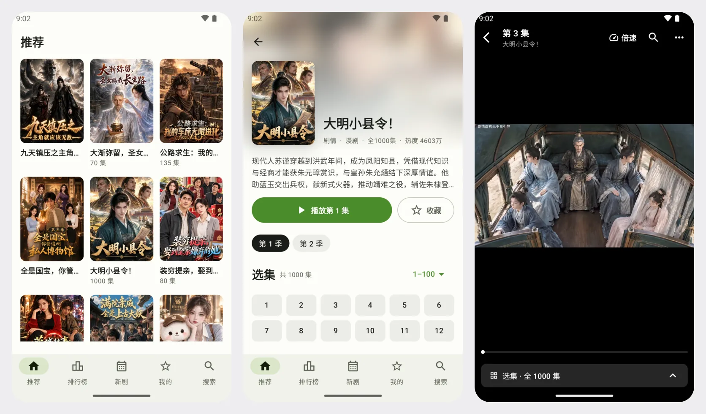

<p align="center">
  
</p>

<h1 align="center">开心果 Android</h1>

<p align="center">
  <b>无广告、不烧心</b><br>
  红果短剧的极简 Android 客户端，华为手机也能用
</p>

开心果 Android 是 [开心果](https://github.com/kadaliao/kaixinguo)（macOS）和 [开心果 iOS](https://github.com/kadaliao/kaixinguo-ios) 的 Android 版：没有广告、没有弹窗，打开就是剧。界面用 Jetpack Compose 写成，播放用 Media3 ExoPlayer，支持画中画、锁屏和通知栏控制。不依赖谷歌服务，华为、荣耀、小米、OPPO、vivo 的手机都能装。



## 功能

- **发现**：推荐、排行榜（按类型和榜单）、新剧上线（前后一周的日历）、热搜榜，下拉刷新
- **搜索**：边输入边联想，同一部剧的各季按顺序排好
- **收藏**：剧集页点「收藏」，或在任意列表里长按海报
- **续播**：记住每部剧看到第几集、第几秒，「我的 › 最近观看」一点就接着看；看完的集在选集里打勾
- **接着上次**：退出后再打开，回到离开时的页面；正在放的剧从原处接着放
- **连播**：一集放完自动下一集，一季看完接下一季
- **选集**：长剧每 100 集一段，多季的剧一键切换
- **沉浸式播放**：视频铺满屏幕，播放几秒不碰屏幕，进度条、按钮和系统栏就都隐去；点一下画面显示出来，再点暂停。画面中间上滑下一集、下滑上一集，左边上下滑调亮度，右边上下滑调音量（最大到 150%）；顶部切倍速、搜别的剧，「⋯」里调清晰度、定时关闭
- **投屏**：顶部的投屏按钮选同一个 Wi-Fi 里的电视、盒子或投影仪（DLNA），视频在电视上放，手机当遥控器；退到后台、熄屏也接着放
- **预加载**：一集正常播放十来秒后，先把下一集开头的一段下载、解密好，切到下一集几乎不用等
- **长按倍速**：按住画面 2 倍速播放，松手恢复；按住时下滑锁定 2 倍速，之后再按住上滑取消
- **弹幕**：精选弹幕从画面上方飘过，跟着进度走，暂停时停住；「⋯」里可以关掉
- **签名服务**：可以填一个自己部署的签名服务，红果改签名校验、内置签名播不了时，播放改用它取地址（见[常见问题](#常见问题)）
- **画中画**：播放时回到桌面，视频缩到小窗里继续放；点小窗回到播放页，关掉小窗就停
- **锁屏和通知栏**：显示剧名、集数和封面，可以暂停、拖动、换集；熄屏也能接着听
- **平板和折叠屏**：宽屏时标签栏换到左侧，播放页右边是选集面板，点顶部的全屏按钮可以收起，支持外接键盘
- **电视**：同一个 APK 装到 Android 电视或电视盒子上，从电视桌面打开，用遥控器选剧、选集、播放（见[电视](#电视)）
- 跟随系统的浅色和深色外观

## 安装

开心果 Android 不在应用商店上架。到 [Releases](https://github.com/kadaliao/kaixinguo-android/releases/latest) 下载 APK，传到手机上点开安装，或者直接用手机浏览器打开这个页面下载：

| 下载哪个 | 适合 |
| --- | --- |
| `kai-xin-guo-<版本>-arm64-v8a.apk` | 近几年的手机，包括华为、荣耀（约 13 MB） |
| `kai-xin-guo-<版本>-universal.apk` | 不确定时用这个，哪种都能装（约 37 MB） |
| `kai-xin-guo-<版本>-armeabi-v7a.apk` | 很老的 32 位手机，以及不少电视和电视盒子 |
| `kai-xin-guo-<版本>-x86_64.apk` | 电脑上的模拟器 |

需要 Android 9 或更高版本。出了新版本，下载新的 APK 直接覆盖安装，观看记录和收藏都会保留。

### 华为手机

| 系统 | 怎么装 |
| --- | --- |
| EMUI、HarmonyOS 2 / 3 / 4 | 和其他安卓手机一样，直接装 APK。开心果不用谷歌服务（GMS），这些系统都能正常运行 |
| HarmonyOS NEXT / HarmonyOS 5 及以后（「纯血鸿蒙」） | 系统本身不能装 APK。可以试试应用市场里的「卓易通」等安卓兼容环境；我们没有在这类环境里测试过 |

华为手机上的几点提示：

- 第一次装 APK 时，系统可能要求在「设置 › 系统和更新 › 纯净模式」里关掉纯净模式，或者允许「安装未知应用」。
- 熄屏后还想接着听，在「设置 › 电池 › 启动管理」里把开心果设成「手动管理」并允许后台活动，否则系统可能清掉后台播放。
- 画中画小窗需要在「设置 › 应用 › 开心果」里允许「画中画」（有的系统叫「悬浮窗」）。

### 电视

Android 电视和电视盒子（Android 9 或更高版本）装的是同一个 APK，装好后开心果出现在电视桌面上。不少电视和盒子是 32 位的系统，不确定时下载 `universal` 那个。电视上一般没有浏览器，可以把 APK 拷到 U 盘，插上电视用文件管理器打开安装；或者在电视的开发者选项里打开网络调试，用 `adb connect <电视的 IP>` 和 `adb install` 装。

| 遥控器 | 作用 |
| --- | --- |
| 方向键、确认键 | 在海报、按钮和分集之间移动、打开 |
| 返回键 | 退出播放、回到上一页；回到列表时停在刚才选中的海报上 |

播放时：

| 遥控器 | 作用 |
| --- | --- |
| 确认键 | 暂停 / 继续；播放失败时重试 |
| ← → | 快退 / 快进 10 秒 |
| ↑ | 到顶部的倍速、搜索和「⋯」 |
| ↓ | 到右边的选集，方向键选、确认键播放 |
| 返回键 | 从顶部或选集回到视频；在视频上时退出播放 |

### 自己构建

需要 JDK 17 或更新的版本，以及 Android SDK（装过 Android Studio 就有，默认在 `~/Library/Android/sdk`）：

```sh
git clone https://github.com/kadaliao/kaixinguo-android.git
cd kaixinguo-android
echo "sdk.dir=$HOME/Library/Android/sdk" > local.properties
./gradlew assembleRelease
```

第一次构建时 Gradle 会下载 Android SDK 37 平台和所需的依赖。APK 在 `app/build/outputs/apk/release/` 下，也可以连上手机用 `adb install` 装。

自己构建的包用的是你电脑上的调试密钥，和 Releases 里的签名不同，两者不能互相覆盖安装，要先卸载另一个（观看记录和收藏会一起删掉）。

## 使用

| 操作 | 作用 |
| --- | --- |
| 长按海报 | 收藏 / 取消收藏 |
| 长按「最近观看」里的剧 | 继续播放，或从最近观看中移除 |
| 点简介 | 展开 / 收起 |
| 再点一次当前的标签 | 回到这个标签的首页 |
| 播放时在画面中间上滑 / 下滑 | 下一集 / 上一集 |
| 在画面左边上下滑 | 调屏幕亮度，离开播放页后恢复原来的亮度 |
| 在画面右边上下滑 | 调音量；调到系统最大后还能再往上推到 150% |
| 点播放画面 | 进度条和按钮隐去时，显示出来；显示着时，暂停 / 继续 |
| 拖视频底部的进度条 | 跳到那里 |
| 播放页底部「选集」 | 手机上弹出选集面板 |
| 平板上播放页顶部的全屏按钮 | 收起右边的选集，视频占满整个屏幕；再点一次显示选集 |
| 播放页顶部的投屏按钮 | 列出同一个 Wi-Fi 里能投的电视，点一下投过去；再点选「停止投屏，在手机上看」收回 |
| 播放页顶部的搜索 | 搜别的剧，点结果直接播放；点搜索框左边的 ‹ 回来接着放。顶部放不下时在「⋯」里 |
| 播放页的「⋯」 | 倍速、清晰度、定时关闭、弹幕开关、收藏、剧集详情 |
| 按住播放画面 | 2 倍速播放，松手恢复原来的倍速 |
| 按住画面再下滑 | 锁定 2 倍速 |
| 锁定后按住画面再上滑 | 取消 2 倍速，恢复原来的倍速 |
| 横过来 | 手机横屏时只显示视频；点一下画面，按钮和顶部的时间、电量一起出来 |
| 横屏的剧，点播放页顶部倍速旁边的旋转按钮 | 手机上不转手机也能横屏看，再点回到竖屏；关了自动旋转也管用 |
| 播放时回到桌面 | 视频进入画中画小窗 |

平板接上键盘时，播放页里：

| 按键 | 作用 |
| --- | --- |
| 空格 | 暂停 / 继续 |
| ← → | 快退 / 快进 10 秒 |
| ↑ ↓ | 上一集 / 下一集 |
| Esc | 退出播放 |

开心果也认 `kaixinguo://` 链接，可以在别的应用、桌面快捷方式或 `adb` 里用：

| 链接 | 打开 |
| --- | --- |
| `kaixinguo://series/<剧集 ID>` | 剧集详情 |
| `kaixinguo://play/<剧集 ID>?episode=3` | 播放第 3 集；不带 `episode` 时从上次看到的地方接着放 |
| `kaixinguo://search?q=<关键词>` | 搜索 |
| `kaixinguo://discover`、`rank`、`new`、`mine` | 对应的标签页 |

```sh
adb shell am start -a android.intent.action.VIEW -d "kaixinguo://search?q=重生"
```

观看记录和收藏只存在手机上，不会上传，卸载应用时一并删除。文件格式和 macOS、iOS 版相同：

| 内容 | 位置（应用私有目录内） |
| --- | --- |
| 观看记录 | `files/history.json` |
| 收藏 | `files/favorites.json` |
| 离开时在哪（页面、正在放的剧） | `files/session.json` |
| 匿名设备 | `no_backup/openhongguo/anonymous.json`，不参与系统备份 |
| 签名服务的设置（填了才有） | `no_backup/signer.json`，走签名服务的匿名设备在 `no_backup/openhongguo/anonymous-signer.json`，都不参与系统备份 |
| 封面和推荐缓存 | `cache/` |

## 常见问题

**第一次打开，列表很久才出来？**
第一次启动要注册一个匿名设备，网络慢时可能要等十几秒。之后启动会先显示上次的推荐。

**某些剧提示「暂不支持这种视频格式」？**
目前只支持整段的 MP4，分段（DASH/HLS）的长视频还不能播放。

**提示「这台设备解码不了这一集的视频」？**
剧集是 HEVC（H.265）编码的，很老的手机可能没有对应的解码器。在「⋯ › 清晰度」里换低一档试试。

**有的集数带一把锁？**
那一集需要登录红果账号才能看，开心果不提供登录。

**能投屏到电视吗？**
能。播放页顶部点投屏按钮，选你的电视。用的是 DLNA，多数智能电视、电视盒子和投影仪都支持（有的叫「多屏互动」「投屏接收」「DLNA」，可能要在电视上先打开）；不支持 Chromecast 和 AirPlay。视频仍然由手机边下边解密，投屏时手机开一个只有电视知道地址的小服务，电视从它那里取解密后的视频，所以手机和电视要连同一个 Wi-Fi，投屏期间开心果不能被关掉（退到后台、熄屏都可以）。投屏时倍速和 2 倍速按住只对手机有效，电视按正常速度放。找不到电视时，看看手机是不是连着同一个 Wi-Fi、有没有开着 VPN，以及路由器是否开了「AP 隔离」。Android 电视和电视盒子也可以直接装开心果（见[电视](#电视)），不用投屏。

**所有剧都打不开，提示「这一集暂时无法匿名播放」？**
多半是红果服务端改了签名校验，SDK 的内置签名一时跟不上，要等开心果发新版。等不及的话，可以自己部署一个 [openhongguo-signer](https://github.com/beilunyang/openhongguo/tree/main/signer) 签名服务（做法见[部署签名服务](https://github.com/kadaliao/kaixinguo/blob/main/docs/signer.md)），在「我的」右上角的设置里填上它的地址（如 `https://signer.example.com`）和 token。之后内置签名播不了时，开心果会改用签名服务取播放地址，其他请求不经过它；不需要时把地址清空。开心果不提供公共的签名服务。

**加载失败或者播放卡住？**
调试版（`./gradlew installDebug`）会把每个请求打印到 logcat：`adb logcat -s kxg sdk`，提 issue 时附上。

## 开发

```sh
./gradlew testDebugUnitTest   # 逻辑和解密测试：在电脑上直接跑，不需要模拟器和网络
./gradlew installDebug        # 装调试版到连着的手机或模拟器
./gradlew assembleRelease     # 构建发布版 APK
```

动手之前先读 [docs/architecture.md](docs/architecture.md) 和 [CONTRIBUTING.md](CONTRIBUTING.md)。

一句话概括实现：剧集是 CENC（AES-CTR）加密的 HEVC MP4，`cenc/Cenc.kt` 按需原地解密任意字节区间，`CencDataSource` 作为 ExoPlayer 的数据源，边从 CDN 下载边解密交给播放器，可以随意拖动进度；数据来自 openhongguo 的 Android 包。

## 致谢

- [openhongguo](https://github.com/beilunyang/openhongguo)：红果短剧的 SDK，开心果的全部数据都来自它
- [开心果](https://github.com/kadaliao/kaixinguo)（macOS）和 [开心果 iOS](https://github.com/kadaliao/kaixinguo-ios)：本项目的界面、逻辑和解密都照着它们移植

## 许可证

[MIT](LICENSE)

## 免责声明

本项目仅供学习和研究，与红果短剧及其运营方无关。请遵守 openhongguo 的[免责声明](https://github.com/beilunyang/openhongguo#免责声明)，内容版权归原权利人所有。
