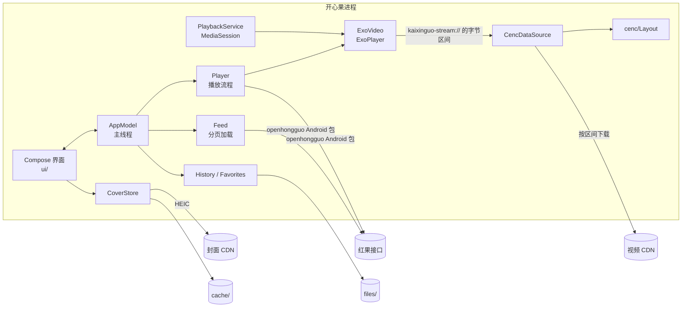

# 架构

这份文档讲开心果 Android 的代码是怎么组织的、各部分怎么配合，以及几处不太显然的设计为什么这样做。它是 [iOS 版](https://github.com/kadaliao/kaixinguo-ios)的移植，两边的概念一一对应，读过 iOS 版的 `docs/architecture.md` 会更快上手。

## 总览



只有一个 Gradle 模块 `app`，按包分层：

| 包 | 内容 | 依赖 Android 吗 |
| --- | --- | --- |
| `cenc` | 解密 | 不依赖，纯 Kotlin + `javax.crypto` |
| `model` | 全部状态和逻辑：目录、分页、剧集页、播放流程、本地存储 | 只用 Compose 的状态（`mutableStateOf`），单元测试直接在电脑上跑 |
| `playback` | ExoPlayer、数据源、媒体会话服务 | 依赖 |
| `covers` | 封面的下载和缓存 | 依赖 |
| `ui` | Compose 界面和路由 | 依赖 |

`KaixinguoApplication` 持有活得和进程一样长的东西：`AppModel`、`ExoVideo`、`CoverStore`、`Router`。`MainActivity` 只是一个窗口，转屏、进出画中画时可能重建，状态都不在它身上。

## 代码地图

| 文件 | 负责什么 | 对应 iOS 版 |
| --- | --- | --- |
| `cenc/Cenc.kt` | 把 CENC 加密的 MP4 按字节区间还原成明文 | `Sources/CENC/CENC.swift` |
| `playback/Streams.kt` | `StreamRegistry`、`StreamSource`、`CencDataSource`：按区间下载、解密、交给 ExoPlayer | `StreamLoader.swift` |
| `playback/ExoVideo.kt` | 唯一的 ExoPlayer，实现 `model.Video` 接口 | `Player.swift` 里的 `AVPlayer` |
| `playback/PlaybackService.kt` | 媒体会话：熄屏播放、通知栏和锁屏控制、上一集 / 下一集按钮 | `MPRemoteCommandCenter` 和后台音频 |
| `model/Player.kt` | 播放流程：解析播放地址、预取下一集、选流、连播、记录进度、倍速、定时关闭、按集加载弹幕 | `Player.swift` |
| `model/Danmaku.kt` | 弹幕：估算每条的宽度、分道，算出某一时刻每条飘到哪里 | 无 |
| `model/AppModel.kt` | 全部状态、各页的 fetcher、热搜、首页缓存、剧集页的加载和续播 | `AppModel.swift`、`SeriesPage.swift` |
| `model/Feed.kt` | 分页加载的列表，去重、自动重试、下拉刷新 | `Feed.swift` |
| `model/SeriesPage.kt` | 剧集详情：分集、选季、分段 | `SeriesPage.swift` |
| `model/Seasons.kt` | 季的编号和排序 | `Seasons.swift` |
| `model/Card.kt` | 卡片和各种文案（集数、热度、日期） | `Card.swift` |
| `model/Store.kt` | JSON 文件存储、观看记录、收藏 | `Store.swift` |
| `model/Session.kt` | 离开应用时在哪：标签页、页面栈、搜索、榜单和日期、倍速和清晰度、弹幕开关、播放页上的那一集 | 无 |
| `model/Catalog.kt` | 对 SDK 的抽象（测试里换成假的）、错误文案 | `Catalog.swift` |
| `covers/CoverStore.kt` | 封面：下载、缩小、磁盘缓存、内存缓存 | `CoverStore.swift` |
| `MainActivity.kt` | 窗口、`kaixinguo://` 链接、画中画、离开时暂停、回来时接着放 | `KaixinguoApp.swift` |
| `ui/App.kt`、`ui/Router.kt` | 标签页（手机底栏、平板侧栏）、每个标签的页面栈 | `RootView.swift`、`Router.swift` |
| `ui/Grid.kt` | 海报网格、卡片、封面、空状态、胶囊、搜索框 | `Grid.swift` |
| `ui/CatalogScreens.kt` | 推荐、排行榜、新剧上线、搜索、热搜、我的 | `CatalogViews.swift` |
| `ui/SeriesScreen.kt` | 剧集详情 | `SeriesView.swift` |
| `ui/PlayerScreen.kt` | 播放页（顶栏、进度条、手势、弹幕、播放页里的搜索）、选集面板 | `PlayerScreen.swift` |

## 线程模型

**`AppModel`、`Feed`、`SeriesPage`、`Player`、`History`、`Favorites`、`Router` 都属于主线程。** 它们的状态是 Compose 的 `mutableStateOf`，界面直接读，Compose 据此决定重组哪些部分，相当于 iOS 版的 `@Observable`。

- 协程都在 `AppModel.scope` 上启动，应用里是 `MainScope()`，测试里是 `runTest` 的 `backgroundScope`。挂起等 SDK 时让出主线程，结果回来后在主线程上改状态。
- 界面里调用的 `model.rankFeed`、`model.searchFeed(q)` 这类方法要能重复调用：它们缓存在普通的 `HashMap` 里，加载前先检查 `loading` 等标记，只发一次请求。
- 不属于主线程的部件各有自己的同步方式：`StreamSource` 用 `@Synchronized` 保证文件头只读一次；`JSONStore` 有自己的写线程；`CoverStore` 在 IO 线程池上解码，去重的表只在主线程上读写；解密用的 `Layout` 建好后不再改变，`Cipher` 按线程各一份。

## 列表：`Feed`

和 iOS 版一样，推荐、排行榜、新剧上线和搜索都是一个 `Feed` 配一个 fetcher：

- 网格滚到距末尾 10 张卡片以内时调用 `loadMore`（`FeedGrid` 用 `snapshotFlow` 盯着最后一个可见的位置）。卡片按 ID 去重；一页里没有新卡片就视为到底，否则搜索会无限请求。
- 列表还是空的时候失败，会在 2、4、8、16 秒后自动重试，之后显示「重试」按钮。
- 推荐页的第一页缓存在 `cache/home.json`。启动时先显示缓存（`stale`），新数据到了排在前面、缓存排在后面，网格只增不减。下拉刷新用的也是这个办法。
- 排行榜、新剧上线和搜索的 `Feed` 按「榜单 / 日期 / 关键词」缓存，切回来时不用重新加载。

## 播放

剧集是 CENC（AES-CTR，ISO/IEC 23001-7）加密的 HEVC MP4。ExoPlayer 自己的 ClearKey 只支持分片的 MP4，开心果给它一个自定义协议的地址，自己当数据源：

1. **解析**（`Player.resolve`）：通过 SDK 取这一集的播放模型和内容密钥。正在播的时候会预取下一集；CDN 地址一分钟内过期的模型会重新取。
2. **选流**（`pickStream`）：默认选分辨率最高、码率最高的一路；看的人在「⋯ › 清晰度」里选过的话，选不高于它的最高一路。分段的 HLS/DASH 和音视频分离的流目前不支持，直接提示。
3. **登记**：`StreamRegistry.register` 为这一集建一个 `StreamSource`（主地址、备用地址和密钥），换回一个 `kaixinguo-stream://episode/<随机 ID>.mp4` 的地址。登记表只保留最近 3 个。
4. **播放**：ExoPlayer 通过 `CencDataSource` 要一个个字节区间。第一次被问到时 `StreamSource.prepare` 读文件头 64 KB，用 `Layout.open` 找到 `moov`，算出每个样本的位置和 IV；之后每个区间都从 CDN 取同一区间，边收边原地解密，再交给播放器。下载断开时从断点接着取，换另一个 CDN 地址，最多两次。HTTP 用的是 Media3 的 `DefaultHttpDataSource`。
5. **回报**：`ExoVideo` 把 ExoPlayer 的状态翻译成 `TimeControl`（暂停、等待、播放），`Player` 据此更新状态，播放时每 3 秒记录进度，播完自动连播下一集或下一季。

`Cenc.kt` 是 iOS 版 `CENC.swift` 的逐行移植，关键同样是**解密不改变任何字节的位置**：样本原地解密，标记加密的盒子改名成同样长度的明文盒子（`encv` → `hvc1`、`sinf` → `free` 等）。所以明文文件的任意区间就是密文文件同一区间解密后的结果，播放器可以随意拖动。`CencTest` 用 JDK 自带的 AES-CTR 从零拼出加密的 MP4 来验证它。

`Player` 不直接碰 ExoPlayer，而是通过 `model.Video` 接口：应用里是 `ExoVideo`，测试里是 `FakeVideo`。这样播放流程（等剧集加载、锁住的集、倍速、定时关闭、离开时取消）都能在电脑上测。

### 后台、锁屏和画中画

- **`PlaybackService`** 是 Media3 的 `MediaSessionService`，包着同一个 ExoPlayer。`MainActivity` 在前台时连着它，开始播放后它把自己升为前台服务，熄屏、锁屏也能接着放，通知栏和锁屏显示剧名、集数和封面。ExoPlayer 一次只放一集，所以会话里的「上一集 / 下一集」按钮用 `ForwardingPlayer` 接到 `Player.step`。
- **画中画**：正在放的时候离开应用，窗口缩成小窗（Android 12 起由系统自动进入，之前在 `onUserLeaveHint` 里手动进入）。小窗里只显示视频：`PlayerScreen` 收到 `inPip` 后隐藏所有控件，`VideoSurface` 留在原处，画面不中断。点小窗回到播放页；关掉小窗时活动已经停了，`onPictureInPictureModeChanged` 据此判断并退出播放。
- **离开时暂停**：没进画中画就离开应用（比如用户关掉了画中画权限），`onStop` 调 `Player.leaveApp` 暂停，记下看到哪里、离开时是不是在放；回来时 `onStart` 调 `returnToApp`，离开时在放就接着放，本来暂停的仍然暂停。离开期间从通知栏点了播放或暂停，以那一下为准。只是熄屏的话不暂停，所以可以锁屏听。

### 弹幕

- **加载**：每集开始时 `Player` 通过 SDK 的 `listDanmaku` 取这一集的弹幕。服务端按播放时间分页，一页是一段时间；某一段没有弹幕时 `items` 为空，后面却可能还有，所以带着 `cursor` 一直翻到 `hasMore` 为假。同一集只取一次（重试、换清晰度不再取），换集时清空，关掉弹幕时不取。取不到就当没有，不影响播放。
- **分道**（`model/Danmaku.kt` 的 `Lanes`）：每条横穿屏幕都用 7 秒，同一条道里后一条追不上前一条。按出现的时间排好，每条放进最上面一条已经空出来的道（前一条连同后面的间隔已经离开右边缘）；都占着就等最先空出来的那条，要等 1.5 秒以上就不显示。宽度按字数估算，以字号为单位：汉字 1、表情 1.2、其他 0.6，宁宽勿窄，所以分道不用量字。
- **绘制**：`PlayerScreen` 的 `DanmakuLayer` 叠在视频上、控件下，从顶栏下面往下 4 条道。每条在哪只看视频的当前时间：播放时每帧读一次 `video.position`，暂停和缓冲时每 250 毫秒读一次，拖进度条也跟得上；所以暂停时停住，倍速时一起变快。每条字在第一次出现时量一次，画两遍：先描深色的边，再填白色。叠层不接手势，点按、滑动、长按照样落到视频上；画中画小窗里不显示。

### 回到离开时的样子

应用被系统回收、被用户从最近任务里划掉，或者被强行停止，再打开时回到离开时的样子：

- **存什么**：`Session` 记着标签页、每个标签的页面栈、搜索框和搜索词、选中的榜单和日期、倍速和清晰度、弹幕开没开，以及播放页上的那一集和它当时是不是在放。看到第几秒不在这里，用观看记录里的。
- **什么时候存**：`KaixinguoApplication` 用 `snapshotFlow` 盯着这些状态，一变就存到 `files/session.json`（写盘和观看记录一样在后台线程）；`onStop` 再存一次并等它落盘。这样在后台连播到下一集、关掉画中画这类离开以后的变化也能记下。
- **怎么恢复**：`AppModel` 启动时读回自己那部分（榜单、日期、倍速、清晰度），`Router.restore` 读回标签页和页面栈。播放页要等窗口打开：本次启动的第一个窗口调 `reopenPlayer`，从观看记录里那一秒往前 3 秒打开那一集，离开时在放就接着放，暂停的就停在那一帧。进程可能先被媒体服务拉起来、过一会儿才开窗口，所以还没重新打开的那一集照样写回文件。
- **链接优先**：用 `kaixinguo://` 链接打开时去链接说的地方，不再打开上次的播放页。
- 选中的新剧日期只在同一天有效，隔天打开回到「今天」。

### 华为和其他国产系统

- 不依赖 Google Play 服务：依赖里只有 AndroidX、Media3 和 openhongguo，没有 `com.google.android.gms`。
- `minSdk` 是 28（Android 9）：系统从这一版起能解 CDN 给的 HEIC 封面。EMUI 9 以后、HarmonyOS 2–4 都满足。
- HEVC 解码失败时，`DefaultRenderersFactory.setEnableDecoderFallback(true)` 让 ExoPlayer 换别的解码器再试；都不行就提示换低一档清晰度。
- 按 CPU 架构拆包，华为、荣耀的手机装 `arm64-v8a` 那一个，openhongguo 的 Go 库每种架构约 8 MB。
- HarmonyOS NEXT 不运行 APK；原生鸿蒙版需要另起一个 ArkTS 工程，openhongguo 也还没有鸿蒙的包。

## 封面

封面 CDN 只给 HEIC，`ImageDecoder` 从 Android 9 起直接能解。`CoverStore` 解码时缩小到最长边 600 像素，以 JPEG 存到 `cache/covers/`，内存里用 `LruCache` 保留解码后的位图（上限 96 MB）。

- 缓存的键是去掉查询参数的 URL 的 SHA-1，因为签名参数每次都变。
- 同一张封面同时被多处请求时只下载一次。
- 界面先同步查内存缓存，有就直接显示，没有才异步加载并淡入，滚动时不闪。
- 剧集页顶部的模糊背景是把封面缩到 12×16 像素再拉伸开，任何版本的 Android 都能模糊；Android 12 起再叠一层真正的模糊。

## 界面

- **导航**：`NavigationSuiteScaffold` 在手机上是底栏，在平板和展开的折叠屏上是侧边栏。每个标签有自己的页面栈（`Router.paths`），`TabHost` 用 `SaveableStateHolder` 给每一页保存状态，切换标签、返回时网格停在原来滚到的地方；页面出栈时状态一并删掉。没有用 Navigation 库。
- **播放页**盖在所有标签之上（`App` 里的 `AnimatedVisibility`），始终是深色。手势都在 `Gestures` 里：按下后等到长按的时限，期间抬起是点按，移动超过阈值是滑动（竖着才算），都没有就是长按。
- **返回**：系统返回键先关掉播放页里的搜索，再退出播放，再一层层退出页面栈，最后从其他标签回到「推荐」。

## 本地数据

| 文件 | 内容 | 写入方 |
| --- | --- | --- |
| `files/history.json` | 观看记录，最近的在前，最多 200 部；每部记着看到哪里和看完了哪几集 | `History` |
| `files/favorites.json` | 收藏，最近收藏的在前 | `Favorites` |
| `files/session.json` | 离开应用时在哪，下次打开回到那里；只有 Android 版有 | `AppModel`、`Router` |
| `no_backup/openhongguo/anonymous.json` | SDK 注册的匿名设备，不参与备份 | openhongguo |
| `cache/home.json` | 推荐页第一页 | `AppModel` |
| `cache/covers/` | 封面 JPEG | `CoverStore` |

`history.json` 和 `favorites.json` 的格式与 macOS、iOS 版相同（字段名一样，时间是 RFC 3339），几个版本的文件可以互相读。`JSONStore` 的规则也一样：

- 主线程改完列表调用 `save`，后台线程写盘；还没来得及写的旧快照直接丢弃，只写最新的。
- 写到旁边的临时文件再原子地换过去，中途崩溃也不会留下半个文件。
- 文件不存在或读不出来时当作空列表；某一条读不出来就跳过这一条。
- 应用退到后台时（`MainActivity.onStop`）调用 `flush`，等最后一次写入落盘。

字段一旦发布就要保持兼容：只能加字段，不能改名或删除，新字段解码时要有默认值。

## 测试

```sh
./gradlew testDebugUnitTest
```

- **逻辑测试**（`model/CatalogTest.kt`、`model/SessionTest.kt`、`model/DanmakuTest.kt`）用 `FakeCatalog` 和 `FakeVideo` 代替 SDK 和 ExoPlayer，不联网，用协程测试的虚拟时间跑重试和定时关闭：分页和去重、缓存合并、自动重试、搜索回退和补封面、选季和续播、播放状态、长按倍速、定时关闭、弹幕的加载和分道、观看记录和收藏的读写（包括 Go 写的文件）、离开再回来和重新启动后回到原处。
- **解密测试**（`cenc/CencTest.kt`）在测试里从零拼出加密的 MP4（用 JDK 自己的 CTR 模式加密，不拿解密器验证自己），覆盖 senc、子样本、saiz/saio、moov 在文件末尾等情况，整段和任意切片解密结果必须一致。

拿一集真实的加密剧集和 Go 版的输出逐字节比较：

```sh
CENC_SAMPLE=enc.mp4 CENC_KEY=<密钥> CENC_CLEAR=clear.mp4 ./gradlew testDebugUnitTest --tests '*CencTest.decryptsRealEpisode'
```

## 已知限制

- 不支持分段（DASH/HLS）和音视频分离的流。
- 需要登录才能看的集数不能播放，应用不提供登录。
- 投屏只能用系统的屏幕镜像。
- HarmonyOS NEXT 上不能直接安装。
