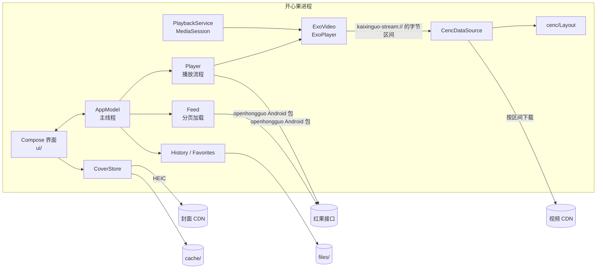

# 架构

这份文档讲开心果 Android 的代码是怎么组织的、各部分怎么配合，以及几处不太显然的设计为什么这样做。它是 [iOS 版](https://github.com/kadaliao/kaixinguo-ios)的移植，两边的概念一一对应，读过 iOS 版的 `docs/architecture.md` 会更快上手。

## 总览



只有一个 Gradle 模块 `app`，按包分层：

| 包 | 内容 | 依赖 Android 吗 |
| --- | --- | --- |
| `cenc` | 解密 | 不依赖，纯 Kotlin + `javax.crypto` |
| `model` | 全部状态和逻辑：目录、分页、剧集页、播放流程、本地存储 | 只用 Compose 的状态（`mutableStateOf`），单元测试直接在电脑上跑 |
| `playback` | ExoPlayer、数据源、媒体会话服务 | 依赖 |
| `covers` | 封面的下载和缓存 | 依赖 |
| `ui` | Compose 界面和路由 | 依赖 |

`KaixinguoApplication` 持有活得和进程一样长的东西：`AppModel`、`ExoVideo`、`CoverStore`、`Router`。`MainActivity` 只是一个窗口，转屏、进出画中画时可能重建，状态都不在它身上。

## 代码地图

| 文件 | 负责什么 | 对应 iOS 版 |
| --- | --- | --- |
| `cenc/Cenc.kt` | 把 CENC 加密的 MP4 按字节区间还原成明文 | `Sources/CENC/CENC.swift` |
| `playback/Streams.kt` | `StreamRegistry`、`StreamSource`、`CencDataSource`：按区间下载、解密、交给 ExoPlayer；预读文件开头 | `StreamLoader.swift` |
| `playback/ExoVideo.kt` | 唯一的 ExoPlayer，实现 `model.Video` 接口；音量超过系统最大时的增益 | `Player.swift` 里的 `AVPlayer`、`AudioBoost.swift` |
| `playback/CastVideo.kt` | 模型看到的 `Video`：没投屏时转给 `ExoVideo`，投屏时把加载、播放、暂停、拖动变成 DLNA 命令，每秒问电视放到哪里 | `Player.swift` 的投屏部分 |
| `playback/Dlna.kt` | DLNA：SSDP 找电视、读设备描述、SOAP 命令，自带一个只够用的 HTTP 客户端 | 无（iOS 用 AirPlay） |
| `playback/StreamServer.kt` | 投屏用的本机 HTTP 服务：按区间把解密后的视频交给电视 | `StreamServer.swift` |
| `playback/CastSessionPlayer.kt` | 投屏时媒体会话里的播放器：通知栏、锁屏、音量键控制电视 | 无 |
| `playback/PlaybackService.kt` | 媒体会话：熄屏播放、通知栏和锁屏控制、上一集 / 下一集按钮 | `MPRemoteCommandCenter` 和后台音频 |
| `model/Player.kt` | 播放流程：解析播放地址、预取和预读下一集、选流、连播、记录进度、倍速、定时关闭、按集加载弹幕 | `Player.swift` |
| `model/Danmaku.kt` | 弹幕：估算每条的宽度、分道，算出某一时刻每条飘到哪里 | 无 |
| `model/AppModel.kt` | 全部状态、各页的 fetcher、热搜、首页缓存、剧集页的加载和续播 | `AppModel.swift`、`SeriesPage.swift` |
| `model/Feed.kt` | 分页加载的列表，去重、自动重试、下拉刷新 | `Feed.swift` |
| `model/SeriesPage.kt` | 剧集详情：分集、选季、分段 | `SeriesPage.swift` |
| `model/Seasons.kt` | 季的编号和排序 | `Seasons.swift` |
| `model/Card.kt` | 卡片和各种文案（集数、热度、日期） | `Card.swift` |
| `model/Store.kt` | JSON 文件存储、观看记录、收藏 | `Store.swift` |
| `model/Session.kt` | 离开应用时在哪：标签页、页面栈、搜索、榜单和日期、倍速和清晰度、弹幕开关、播放页上的那一集 | 无 |
| `model/Catalog.kt` | 对 SDK 的抽象（测试里换成假的）、错误文案 | `Catalog.swift` |
| `model/Signer.kt` | 签名服务：播放取址在内置签名失效时改用签名服务、设置的读写和检查 | `signer.go`（macOS） |
| `covers/CoverStore.kt` | 封面：下载、缩小、磁盘缓存、内存缓存 | `CoverStore.swift` |
| `MainActivity.kt` | 窗口、`kaixinguo://` 链接、画中画、离开时暂停、回来时接着放 | `KaixinguoApp.swift` |
| `ui/App.kt`、`ui/Router.kt` | 标签页（手机底栏、平板侧栏）、每个标签的页面栈 | `RootView.swift`、`Router.swift` |
| `ui/Grid.kt` | 海报网格、卡片、封面、空状态、胶囊、搜索框 | `Grid.swift` |
| `ui/CatalogScreens.kt` | 推荐、排行榜、新剧上线、搜索、热搜、我的 | `CatalogViews.swift` |
| `ui/SeriesScreen.kt` | 剧集详情 | `SeriesView.swift` |
| `ui/PlayerScreen.kt` | 播放页（顶栏、进度条、控件的隐去、手势、亮度和音量、弹幕、播放页里的搜索）、选集面板 | `PlayerScreen.swift` |
| `ui/Settings.kt` | 设置（「我的」右上角）：签名服务的地址和 token | `settings.go`（macOS） |

## 线程模型

**`AppModel`、`Feed`、`SeriesPage`、`Player`、`History`、`Favorites`、`Router` 都属于主线程。** 它们的状态是 Compose 的 `mutableStateOf`，界面直接读，Compose 据此决定重组哪些部分，相当于 iOS 版的 `@Observable`。

- 协程都在 `AppModel.scope` 上启动，应用里是 `MainScope()`，测试里是 `runTest` 的 `backgroundScope`。挂起等 SDK 时让出主线程，结果回来后在主线程上改状态。
- 界面里调用的 `model.rankFeed`、`model.searchFeed(q)` 这类方法要能重复调用：它们缓存在普通的 `HashMap` 里，加载前先检查 `loading` 等标记，只发一次请求。
- 不属于主线程的部件各有自己的同步方式：`StreamSource` 用 `@Synchronized` 保证文件头只读一次；`JSONStore` 有自己的写线程；`CoverStore` 在 IO 线程池上解码，去重的表只在主线程上读写；解密用的 `Layout` 建好后不再改变，`Cipher` 按线程各一份。

## 列表：`Feed`

和 iOS 版一样，推荐、排行榜、新剧上线和搜索都是一个 `Feed` 配一个 fetcher：

- 网格滚到距末尾 10 张卡片以内时调用 `loadMore`（`FeedGrid` 用 `snapshotFlow` 盯着最后一个可见的位置）。卡片按 ID 去重；一页里没有新卡片就视为到底，否则搜索会无限请求。
- 列表还是空的时候失败，会在 2、4、8、16 秒后自动重试，之后显示「重试」按钮。
- 推荐页的第一页缓存在 `cache/home.json`。启动时先显示缓存（`stale`），新数据到了排在前面、缓存排在后面，网格只增不减。下拉刷新用的也是这个办法。
- 排行榜、新剧上线和搜索的 `Feed` 按「榜单 / 日期 / 关键词」缓存，切回来时不用重新加载。

## 播放

剧集是 CENC（AES-CTR，ISO/IEC 23001-7）加密的 HEVC MP4。ExoPlayer 自己的 ClearKey 只支持分片的 MP4，开心果给它一个自定义协议的地址，自己当数据源：

1. **解析**（`Player.resolve`）：通过 SDK 取这一集的播放模型和内容密钥。正在播的时候会预取下一集；CDN 地址一分钟内过期的模型会重新取。
2. **选流**（`pickStream`）：默认选分辨率最高、码率最高的一路；看的人在「⋯ › 清晰度」里选过的话，选不高于它的最高一路。分段的 HLS/DASH 和音视频分离的流目前不支持，直接提示。
3. **登记**：`StreamRegistry.register` 为这一集建一个 `StreamSource`（主地址、备用地址和密钥），换回一个 `kaixinguo-stream://episode/<随机 ID>.mp4` 的地址。登记表只保留最近 3 个。
4. **播放**：ExoPlayer 通过 `CencDataSource` 要一个个字节区间。第一次被问到时 `StreamSource.prepare` 读文件头 64 KB，用 `Layout.open` 找到 `moov`，算出每个样本的位置和 IV；之后每个区间都从 CDN 取同一区间，边收边原地解密，再交给播放器。下载断开时从断点接着取，换另一个 CDN 地址，最多两次。HTTP 用的是 Media3 的 `DefaultHttpDataSource`。
5. **回报**：`ExoVideo` 把 ExoPlayer 的状态翻译成 `TimeControl`（暂停、等待、播放），`Player` 据此更新状态，播放时每 3 秒记录进度，播完自动连播下一集或下一季。

### 预读下一集

和 iOS 版一样：`Player.resolve` 在一集开始播放时就取下一集的播放模型（地址和密钥）。这一集正常播放满 3 个 3 秒的周期（约 9 秒，按 `video.status == PLAYING` 计，缓冲和暂停不算）后，`preloadNext` 用 `Streams.preload` 为下一集登记一个 `StreamSource`，在 `StreamRegistry` 自己的后台线程上读文件头、算好解密布局，再把开头约 20 秒（按码率算，2～8 MB）下载下来解密，留在内存里。

- `StreamSource.prefix` 是从第 0 字节起的明文：文件头读来学布局的 64 KB，加上预读的部分。`CencDataSource` 要的区间落在里面的部分直接从内存给，到了末尾再去 CDN 取；已经开始的下载不会因为预读又多了一段而改回内存。
- 切到下一集时，`makeItem` 看预读的是不是这一集、这一路流（地址一样），登记表里还在不在，是就直接用它的地址，不是就新登记一个。又预读了别的集时，旧的那份 `drop` 掉。下一季的第一集只有在它的剧集页已经加载好时才预读。
- 预读失败不算数：`prepare(soft = true)` 的失败不记下来，播放时会重新试。

`Cenc.kt` 是 iOS 版 `CENC.swift` 的逐行移植，关键同样是**解密不改变任何字节的位置**：样本原地解密，标记加密的盒子改名成同样长度的明文盒子（`encv` → `hvc1`、`sinf` → `free` 等）。所以明文文件的任意区间就是密文文件同一区间解密后的结果，播放器可以随意拖动。`CencTest` 用 JDK 自带的 AES-CTR 从零拼出加密的 MP4 来验证它。

`Player` 不直接碰 ExoPlayer，而是通过 `model.Video` 接口：应用里是 `ExoVideo`，测试里是 `FakeVideo`。这样播放流程（等剧集加载、锁住的集、倍速、定时关闭、离开时取消）都能在电脑上测。

### 后台、锁屏和画中画

- **`PlaybackService`** 是 Media3 的 `MediaSessionService`，包着同一个 ExoPlayer。`MainActivity` 在前台时连着它，开始播放后它把自己升为前台服务，熄屏、锁屏也能接着放，通知栏和锁屏显示剧名、集数和封面。ExoPlayer 一次只放一集，所以会话里的「上一集 / 下一集」按钮用 `ForwardingPlayer` 接到 `Player.step`。
- **画中画**：正在放的时候离开应用，窗口缩成小窗（Android 12 起由系统自动进入，之前在 `onUserLeaveHint` 里手动进入）。小窗里只显示视频：`PlayerScreen` 收到 `inPip` 后隐藏所有控件，`VideoSurface` 留在原处，画面不中断。点小窗回到播放页；关掉小窗时活动已经停了，`onPictureInPictureModeChanged` 据此判断并退出播放。
- **离开时暂停**：没进画中画就离开应用（比如用户关掉了画中画权限），`onStop` 调 `Player.leaveApp` 暂停，记下看到哪里、离开时是不是在放；回来时 `onStart` 调 `returnToApp`，离开时在放就接着放，本来暂停的仍然暂停。离开期间从通知栏点了播放或暂停，以那一下为准。只是熄屏的话不暂停，所以可以锁屏听。

### 投屏

Android 上没有 AirPlay，Chromecast 要谷歌服务，所以投屏用 DLNA（UPnP AV），国内的电视、盒子和投影仪基本都支持。思路和 iOS 版一样：电视自己去取视频，手机解密后经本机 HTTP 交给它。

- **找电视**（`Dlna.search`）：在 Wi-Fi 网卡上往 `239.255.255.250:1900` 发 SSDP 的 `M-SEARCH`（找 `MediaRenderer` 和 `AVTransport`），收集回应里的 `LOCATION`，再读设备描述，取名字和 AVTransport、RenderingControl 的控制地址。搜索时拿着 `MulticastLock`，一次搜 4 秒；这一轮没回应的电视从列表里去掉，正在投的除外。
- **HTTP**：Android 不许应用自己的 HTTP 客户端用明文，电视又只说 HTTP，所以 `Http` 直接在 socket 上说 HTTP/1.1（一个请求一个连接，认 `Content-Length` 和 chunked），不为此放开整个应用的明文限制。
- **本机服务**（`StreamServer`）：投屏时在系统分配的端口上监听，地址是 Wi-Fi 的 IPv4，路径是登记表里那一集的随机 ID（`/episode/<UUID>.mp4`），不在登记表里的一律 404。支持 `GET`、`HEAD` 和 `Range`（`a-b`、`a-`、`-n`，多段只取第一段），带上 DLNA 要的 `contentFeatures.dlna.org`，每个响应都 `Connection: close`。区间交给一个新的 `CencDataSource` 去读，所以预读、换 CDN、断点重试、解密都和本机播放共用；电视挂断（它拖动时就会）时写入失败，这个下载跟着停。
- **控制**（`CastVideo`）：它就是交给 `AppModel` 的那个 `Video`。没投屏时一切转给 `ExoVideo`；投屏时 `load` 变成 `SetAVTransportURI`（带 DIDL-Lite 元数据），`play`、`pause`、`seek` 变成 `Play`、`Pause`、`Seek`，命令在自己的线程上按顺序发。每秒问一次 `GetTransportInfo` 和 `GetPositionInfo`，翻译成 `TimeControl` 和进度；两次之间进度按时间往前推，进度条和倍速提示照常。刚发出命令的 2.5 秒里电视报的状态可能还是之前的，不采用。开头要从中间放时，等电视进入播放或暂停后再 `Seek`。电视报 `STOPPED` 时，之前在放、而且停在离结尾 5 秒以内，就算放完，`Player` 接着放下一集；否则当作电视那边停了。连续 5 次问不到，停止投屏，在播放页说明原因。
- **开始和停止**：投过去时记下手机上的位置和是否在放，`ExoVideo` 清掉当前这一集，电视从那一秒开始；停止时反过来，手机从电视放到的地方接着。投屏期间拿着 Wi-Fi 锁和 `PARTIAL_WAKE_LOCK`，熄屏后服务照样能响应。
- **后台**：`PlaybackService` 的媒体会话投屏时换成 `CastSessionPlayer`（`SimpleBasePlayer`），它报的是电视的状态，设备类型是远程，音量是电视的（RenderingControl 的 0–100），所以通知栏、锁屏能暂停、拖动、换集，音量键调的是电视；会话在播，前台服务就一直在，应用不会被系统收掉。`Player.leaveApp` 遇到 `video.remote` 不暂停，画中画也不在投屏时进入。
- **播放页**：投屏时用「正在投屏 / 投屏已暂停」和电视名字盖住画面，不画弹幕，暂停图标也不画；右边上下滑调电视音量，最多 100%；屏幕不再保持常亮，手机只是遥控器。
- **调试**：模拟器的网络出不了组播，搜不到电视。Debug 构建启动时认 `--es kx_renderer <设备描述 URL>`，直接加上一台电视，配合在电脑上跑的假电视测试：

  ```sh
  adb shell am start -n com.kadaliao.kaixinguo/.MainActivity --es kx_renderer http://10.0.2.2:8200/desc.xml
  ```

  电视看到的地址是模拟器内部的 IP，假电视要用 `adb forward` 转到本机再取。

### 弹幕

- **加载**：每集开始时 `Player` 通过 SDK 的 `listDanmaku` 取这一集的弹幕。服务端按播放时间分页，一页是一段时间；某一段没有弹幕时 `items` 为空，后面却可能还有，所以带着 `cursor` 一直翻到 `hasMore` 为假。同一集只取一次（重试、换清晰度不再取），换集时清空，关掉弹幕时不取。取不到就当没有，不影响播放。
- **分道**（`model/Danmaku.kt` 的 `Lanes`）：每条横穿屏幕都用 7 秒，同一条道里后一条追不上前一条。按出现的时间排好，每条放进最上面一条已经空出来的道（前一条连同后面的间隔已经离开右边缘）；都占着就等最先空出来的那条，要等 1.5 秒以上就不显示。宽度按字数估算，以字号为单位：汉字 1、表情 1.2、其他 0.6，宁宽勿窄，所以分道不用量字。
- **绘制**：`PlayerScreen` 的 `DanmakuLayer` 叠在视频上、控件下，从顶栏下面往下 4 条道。每条在哪只看视频的当前时间：播放时每帧读一次 `video.position`，暂停和缓冲时每 250 毫秒读一次，拖进度条也跟得上；所以暂停时停住，倍速时一起变快。每条字在第一次出现时量一次，画两遍：先描一圈淡淡的深色边，再填带一点阴影的半透明白字（第二遍要明写 `drawStyle = Fill`，不写会沿用第一遍的描边，字就成了空心的）。从右边进来的头 1 个字宽淡入，尾巴离左边缘还有 2.5 个字宽时开始淡出，字完全出画时正好消失；淡入淡出按位置（字宽）算而不按时间，所以手机竖屏和平板横屏上淡入淡出走过的距离一样。叠层不接手势，点按、滑动、长按照样落到视频上；画中画小窗里不显示。

### 回到离开时的样子

应用被系统回收、被用户从最近任务里划掉，或者被强行停止，再打开时回到离开时的样子：

- **存什么**：`Session` 记着标签页、每个标签的页面栈、搜索框和搜索词、选中的榜单和日期、倍速和清晰度、弹幕开没开，以及播放页上的那一集和它当时是不是在放。看到第几秒不在这里，用观看记录里的。
- **什么时候存**：`KaixinguoApplication` 用 `snapshotFlow` 盯着这些状态，一变就存到 `files/session.json`（写盘和观看记录一样在后台线程）；`onStop` 再存一次并等它落盘。这样在后台连播到下一集、关掉画中画这类离开以后的变化也能记下。
- **怎么恢复**：`AppModel` 启动时读回自己那部分（榜单、日期、倍速、清晰度），`Router.restore` 读回标签页和页面栈。播放页要等窗口打开：本次启动的第一个窗口调 `reopenPlayer`，从观看记录里那一秒往前 3 秒打开那一集，离开时在放就接着放，暂停的就停在那一帧。进程可能先被媒体服务拉起来、过一会儿才开窗口，所以还没重新打开的那一集照样写回文件。
- **链接优先**：用 `kaixinguo://` 链接打开时去链接说的地方，不再打开上次的播放页。
- 选中的新剧日期只在同一天有效，隔天打开回到「今天」。

### 华为和其他国产系统

- 不依赖 Google Play 服务：依赖里只有 AndroidX、Media3 和 openhongguo，没有 `com.google.android.gms`。
- `minSdk` 是 28（Android 9）：系统从这一版起能解 CDN 给的 HEIC 封面。EMUI 9 以后、HarmonyOS 2–4 都满足。
- HEVC 解码失败时，`DefaultRenderersFactory.setEnableDecoderFallback(true)` 让 ExoPlayer 换别的解码器再试；都不行就提示换低一档清晰度。
- 按 CPU 架构拆包，华为、荣耀的手机装 `arm64-v8a` 那一个，openhongguo 的 Go 库每种架构约 8 MB。
- HarmonyOS NEXT 不运行 APK；原生鸿蒙版需要另起一个 ArkTS 工程，openhongguo 也还没有鸿蒙的包。

## 封面

封面 CDN 只给 HEIC，`ImageDecoder` 从 Android 9 起直接能解。`CoverStore` 解码时缩小到最长边 600 像素，以 JPEG 存到 `cache/covers/`，内存里用 `LruCache` 保留解码后的位图（上限 96 MB）。

- 缓存的键是去掉查询参数的 URL 的 SHA-1，因为签名参数每次都变。
- 同一张封面同时被多处请求时只下载一次。
- 界面先同步查内存缓存，有就直接显示，没有才异步加载并淡入，滚动时不闪。
- 剧集页顶部的模糊背景是把封面缩到 12×16 像素再拉伸开，任何版本的 Android 都能模糊；Android 12 起再叠一层真正的模糊。

## 界面

- **导航**：`NavigationSuiteScaffold` 在手机上是底栏，在平板和展开的折叠屏上是侧边栏。每个标签有自己的页面栈（`Router.paths`），`TabHost` 用 `SaveableStateHolder` 给每一页保存状态，切换标签、返回时网格停在原来滚到的地方；页面出栈时状态一并删掉。没有用 Navigation 库。
- **播放页**盖在所有标签之上（`App` 里的 `AnimatedVisibility`），始终是深色。手势都在 `Gestures` 里：按下后等到长按的时限，期间抬起是点按，移动超过阈值是滑动，都没有就是长按。竖着滑按手指落下的位置分三份：中间换集，左边调亮度，右边调音量，滑过视频高度的七成从 0 到满；横着滑不做什么。
- **控件的隐去**：顶栏、进度条、手机竖屏底部的「选集」和系统栏，在视频播放着、4 秒没被碰过时一起淡出（`ChromeTimer`）。`Chrome` 包着每一块：淡出后不再组合里面的内容，只留一块同样高的空白，所以别的东西不动，那里的触摸落到视频上。手机横屏时导航栏一直收起，状态栏照样跟着控件出现，好看时间和电量；播放页总按 `*IgnoringVisibility` 给状态栏留边（竖屏时导航栏也是），系统栏藏起来也不跳。顶栏太窄、「第 N 集」一行放不下时（手机竖屏看横屏的剧，多了旋转按钮），搜索挪进「⋯」，直到顶栏隐去或屏幕转动后再量一次，免得按钮在手指下面挪动。点画面先让它们回来，显示着时点画面才暂停。暂停、出错、开着选集面板、搜索或菜单、按住倍速、调亮度音量、拖进度条时一直显示；TalkBack 开着时不隐去。
- **亮度**：改的是窗口自己的 `screenBrightness`，不需要权限，只在应用在前台时生效。第一次滑时从系统亮度（`Settings.System.SCREEN_BRIGHTNESS`）开始；离开播放页、进画中画时恢复成跟随系统。
- **音量**：系统的媒体音量用 `setStreamVolume` 设，不弹系统的音量面板。到 100% 以后系统音量停在最大，再往上由 `Player.chooseBoost` 让 `ExoVideo` 在 ExoPlayer 的音频会话上开一个 `LoudnessEnhancer`，最多 1.5 倍（约 3.5 dB），它自己压住最响的部分，不会削波。系统音量被调低时（`VOLUME_CHANGED_ACTION`，或者下一次滑动时发现）增益回到 1。
- **返回**：系统返回键先关掉播放页里的搜索，再退出播放，再一层层退出页面栈，最后从其他标签回到「推荐」。
- **电视**：同一个 APK，清单里加了 `LEANBACK_LAUNCHER` 入口和横幅，触摸屏声明为可选。`isTv()` 看的是系统的 `UI_MODE_TYPE_TELEVISION`。电视上界面布局不变（宽屏，侧栏和选集面板），遥控器的方向键由 Compose 自己移动焦点，另外只做了几件事：主题把焦点的高亮调深（`LocalRippleConfiguration`），海报有焦点时加一圈主色描边，播放页的按钮和分集有焦点时加一圈白边（`focusRing`）；遥控器拉不动网格，网格随焦点滚动时还会把下拉刷新的指示器扯出一截悬着，所以电视上 `Refreshable` 不包 `PullToRefreshBox`，推荐页的顶栏放一个「刷新」按钮；每页用 `LocalFocusedCard` 记住最后选中的海报（跟着页面状态保存），回到这一页或关掉播放页时焦点回到它上面；剧集页打开时和播放页关掉后焦点在「播放」按钮上。播放页里视频本身拿着焦点时，确认键暂停或重试（`Player.ok`），左右键快退快进，上键去顶栏的倍速、下键去选集面板里正在放的那一集（面板被全屏按钮收起时先展开，等那一集排好再把焦点交给它），焦点不在视频上时按键交给 Compose 移动焦点，返回键先把焦点带回视频。这些键和触摸一样让隐去的控件回来；顶栏淡出后不在组合里，所以上键只是设下 `PlayerHud.toBar`，由 `TopBar` 显示出来时自己把焦点交给倍速。焦点在顶栏里时控件一直显示，不会把拿着焦点的按钮藏掉。平板接键盘时的快捷键不变。

## 本地数据

| 文件 | 内容 | 写入方 |
| --- | --- | --- |
| `files/history.json` | 观看记录，最近的在前，最多 200 部；每部记着看到哪里和看完了哪几集 | `History` |
| `files/favorites.json` | 收藏，最近收藏的在前 | `Favorites` |
| `files/session.json` | 离开应用时在哪，下次打开回到那里；只有 Android 版有 | `AppModel`、`Router` |
| `no_backup/openhongguo/anonymous.json` | SDK 注册的匿名设备，不参与备份 | openhongguo |
| `no_backup/openhongguo/anonymous-signer.json` | 走签名服务的那个客户端注册的匿名设备，和上面的分开，一边重置设备不影响另一边；没设签名服务时没有 | openhongguo |
| `no_backup/signer.json` | 设置里的签名服务地址和 token，不参与备份；没设时没有 | `AppModel` |
| `cache/home.json` | 推荐页第一页 | `AppModel` |
| `cache/covers/` | 封面 JPEG | `CoverStore` |

`history.json` 和 `favorites.json` 的格式与 macOS、iOS 版相同（字段名一样，时间是 RFC 3339），几个版本的文件可以互相读。`JSONStore` 的规则也一样：

- 主线程改完列表调用 `save`，后台线程写盘；还没来得及写的旧快照直接丢弃，只写最新的。
- 写到旁边的临时文件再原子地换过去，中途崩溃也不会留下半个文件。
- 文件不存在或读不出来时当作空列表；某一条读不出来就跳过这一条。
- 应用退到后台时（`MainActivity.onStop`）调用 `flush`，等最后一次写入落盘。

字段一旦发布就要保持兼容：只能加字段，不能改名或删除，新字段解码时要有默认值。

## 签名服务

红果服务端改签名校验时，SDK 的内置签名会失效，播放取不到地址（`ANONYMOUS_LIMITED` 或 `SIGNATURE_REJECTED`），要等 SDK 发新版。用户可以在设置里填一个自己部署的 openhongguo-signer，规则和 macOS 版一样：

- 默认只用内置签名，应用里不带任何签名服务的地址。
- 只有播放取址（`resolvePlayback`）会改用签名服务；推荐、搜索、分集、弹幕这些请求一律走内置签名，「搜不到」之类正常的空结果不会去问签名服务。
- 先问内置签名；它失败、签名服务拿到了结果，之后 30 分钟先问签名服务，过后再先问内置签名。先问签名服务时它连不上（`SIGNER_UNAVAILABLE`）或同样失败，就再问内置签名，内置签名成功就不再优先签名服务。
- 两边都失败时，给用户看内置签名的错误，不显示签名服务的错误。
- 签名服务的客户端用自己的设备文件（`anonymous-signer.json`），保存设置后立刻换上新的客户端，不用重启应用。
- 保存前先检查：`GET /ready` 要返回 200 和 `"ready":true`，再 `POST /feature-hash`（空请求，带上 token）要返回 400，401 说明 token 不对。检查没过时显示原因，再点一次「仍然保存」照样保存。Android 不允许应用自己用明文的 `http://`，所以填 `http://` 地址时检查不了，但 SDK 自己的连接不受这个限制，保存后照样能用；建议用 `https://`。

## 测试

```sh
./gradlew testDebugUnitTest
```

- **DLNA 测试**（`playback/DlnaTest.kt`）：设备描述和 SSDP 回应的解析、时间格式、元数据转义、`Range` 的解析，以及在本机起一个假电视，验证 SOAP 命令的写法、chunked 回应和错误说明。
- **逻辑测试**（`model/CatalogTest.kt`、`model/SessionTest.kt`、`model/DanmakuTest.kt`、`model/SignerTest.kt`）用 `FakeCatalog` 和 `FakeVideo` 代替 SDK 和 ExoPlayer，不联网，用协程测试的虚拟时间跑重试和定时关闭：分页和去重、缓存合并、自动重试、搜索回退和补封面、选季和续播、播放状态、长按倍速、定时关闭、弹幕的加载和分道、观看记录和收藏的读写（包括 Go 写的文件）、离开再回来和重新启动后回到原处、播放在内置签名和签名服务之间的切换、签名服务的检查（在本机起一个假的服务）和设置的保存。
- **解密测试**（`cenc/CencTest.kt`）在测试里从零拼出加密的 MP4（用 JDK 自己的 CTR 模式加密，不拿解密器验证自己），覆盖 senc、子样本、saiz/saio、moov 在文件末尾等情况，整段和任意切片解密结果必须一致。

拿一集真实的加密剧集和 Go 版的输出逐字节比较：

```sh
CENC_SAMPLE=enc.mp4 CENC_KEY=<密钥> CENC_CLEAR=clear.mp4 ./gradlew testDebugUnitTest --tests '*CencTest.decryptsRealEpisode'
```

## 已知限制

- 不支持分段（DASH/HLS）和音视频分离的流。
- 需要登录才能看的集数不能播放，应用不提供登录。
- 投屏只支持 DLNA，不支持 Chromecast（要谷歌服务）和 AirPlay；手机和电视要在同一个 Wi-Fi 下。投屏时电视按正常速度放，DLNA 改不了倍速。
- HarmonyOS NEXT 上不能直接安装。
